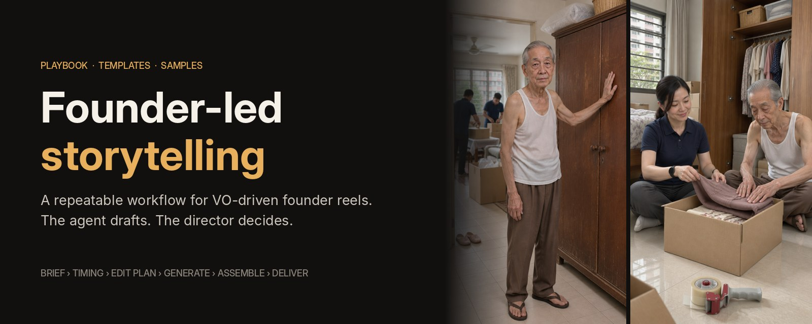
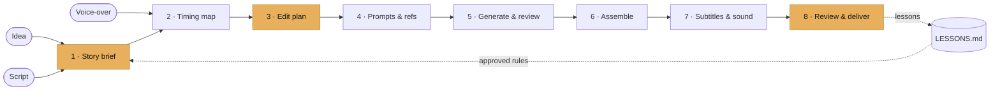

<p align="center">
  
</p>

<p align="center">
  <b>A repeatable production workflow for founder-led storytelling reels.</b><br>
  9:16 · voice-over driven · 3 hooks → bridge → body → organic or ad close
</p>

<p align="center">
  <a href="PLAYBOOK.md">Playbook</a> ·
  <a href="#-templates">Templates</a> ·
  <a href="#-sample-the-last-box">Sample</a> ·
  <a href="LESSONS.md">Lessons</a> ·
  <a href="library/">Library</a>
</p>

---

## ✦ What this is

A playbook an AI editing agent follows **with a creative director**, for any founder, story or campaign.
The agent handles the planning, prompts, checks, rough cuts and file prep. The director decides the story, approves spending, picks the music and gives final approval.

> **The agent drafts. The director decides.**
> Nothing is generated before the brief and the edit plan are approved.

---

## ✦ How it works



<sub>🟧 = a gate the director approves · dotted line = the learning loop</sub>

| Start from | The agent's first move | Timing |
|---|---|---|
| 💡 **Rough idea** | Interviews, drafts the script, and the director picks the arc | `EST` about 2.2 words/s |
| 📝 **Finished script** | Checks the structure and flags gaps | `EST` until the VO arrives |
| 🎙️ **Recorded VO** | Word timestamps, flags possible mishearings | `ACTUAL` |

---

## ✦ Standing rules (short version)

| | |
|---|---|
| 🔊 | **Uploaded SFX only.** No AI sound effects. Missing ones get flagged |
| 🎵 | Free music, licence recorded, VO always clear |
| ⏱️ | The founder's recording sets every cut |
| 🔤 | Generated footage has no text. Overlays and subtitles go on in the edit |
| 📸 | Real photos and footage first. AI only for moments nobody filmed |
| 🎯 | Each line gets a picture only this story could have |

Full list in **[PLAYBOOK.md](PLAYBOOK.md)**.

---

## ✦ Templates

| | Template | Used at |
|---|---|---|
| 📋 | **[Story brief](templates/story-brief.md)**: founder, audience, arc, turning point, visual anchor, ending | Gate 1 |
| 🎬 | **[Edit plan](templates/edit-plan.md)**: VO line → what we see → asset → cut/sound, plus prompts only where needed | Gate 2 |
| ✅ | **[Revision & delivery checklist](templates/revision-delivery-checklist.md)**: continuity, variants, subtitles, sound, naming, approval | Before every export |

---

## ✦ Sample: *The Last Box*

<p align="center">
  
</p>

A fictional Singapore founder, Rachel Lim of Kakis Movers, kept the one box she packed as a kid. Years later she stops a job to pack a grieving uncle's cupboard with him while the truck waits downstairs.

**Turning point:** she sets the tape gun down. **Visual anchor:** the box marked *"Rachel. Don't throw."*

→ **[Script, brief, edit plan, prompts & frames](samples/kakis-movers-last-box.md)**
→ Also: **[Tahi Repair Co. worked example](examples/tahi-repair-co.md)** · **[Real reel traced from script to delivery](case-studies/adrian-reel-2-trace.md)**

---

## ✦ Library & tools

| | |
|---|---|
| 🧩 **[Prompt library](library/prompt-library.md)** | 9 proven patterns: one-line lip sync, reveal, before/after, time passing… |
| ⚠️ **[Slop risks](library/slop-risks.md)** | 15 common AI failures and their fixes |
| 🗒️ **[Founder intake](library/founder-intake.md)** | 14 questions to send before starting |
| 🧮 **[Estimator](library/estimating.md)** | `python3 tools/estimate.py --gen-seconds 19 16 16 --risk high` |
| 📦 **[Logs](logs/)** | Delivery log and hook scoreboard |
| 🤖 **[Agent setup](agent-setup/CLAUDE-snippet.md)** | Paste into your editing agent's `CLAUDE.md` |

---

## ✦ It gets better every project

1. After each review round, the agent logs the director's notes in **[LESSONS.md](LESSONS.md)**.
2. When a lesson repeats across projects, the agent proposes it as a rule.
3. The director approves, and the playbook updates. Nothing changes without a yes.

---

## ✦ Repo map

```
├── PLAYBOOK.md            rules, starting points, 8 stages
├── LESSONS.md             the learning loop
├── templates/             brief · edit plan · checklist
├── library/               prompts · slop risks · intake · estimating
├── tools/estimate.py      credit & time estimator
├── logs/                  delivery log · hook scoreboard
├── samples/               The Last Box (script → frames)
├── examples/              Tahi Repair Co.
├── case-studies/          a real reel, traced
└── agent-setup/           CLAUDE.md snippet
```

<sub>The case study refers to a real client project, so keep this repo private unless it's anonymised. Samples and examples are fictional.</sub>
