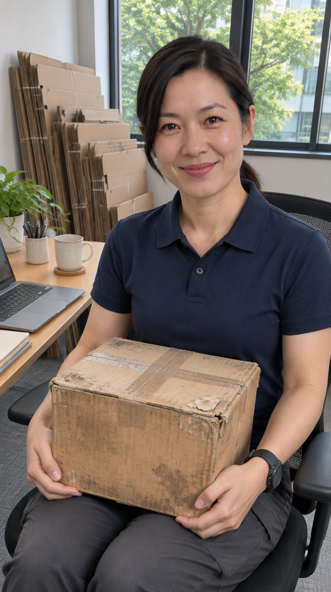
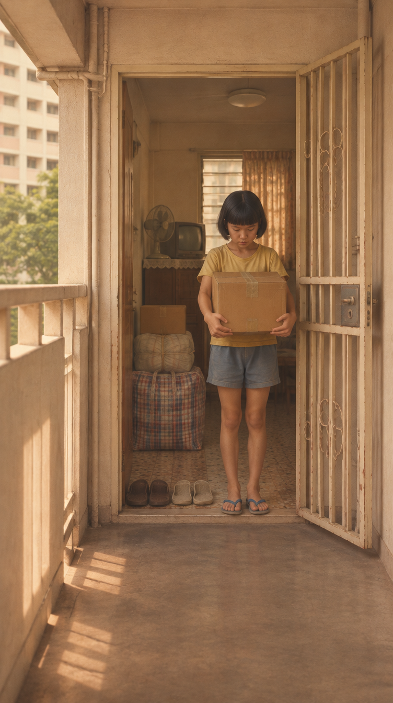
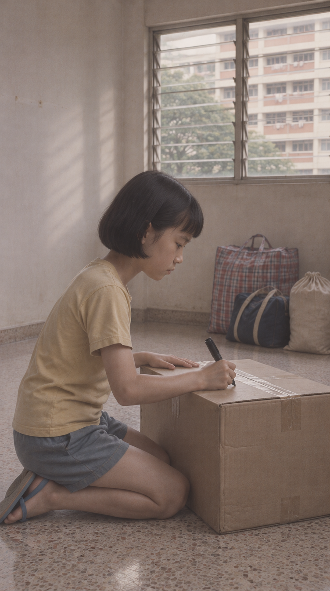
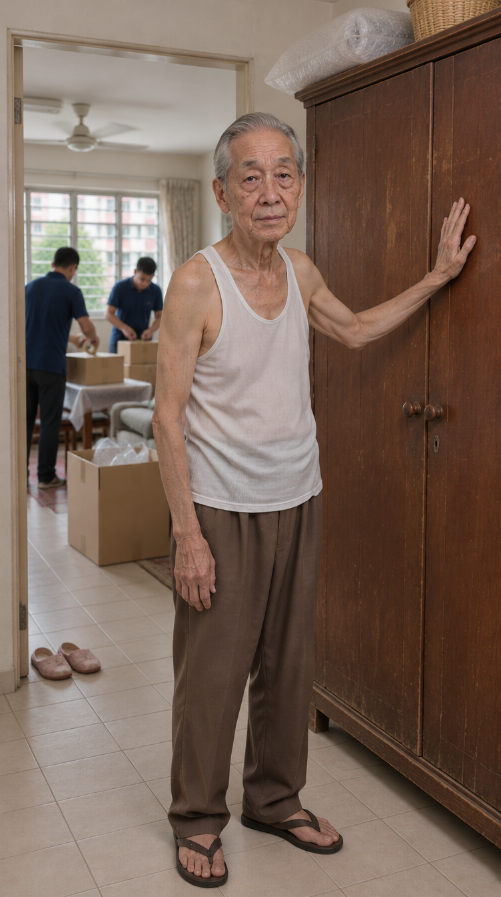
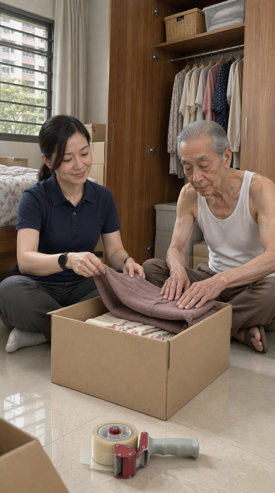
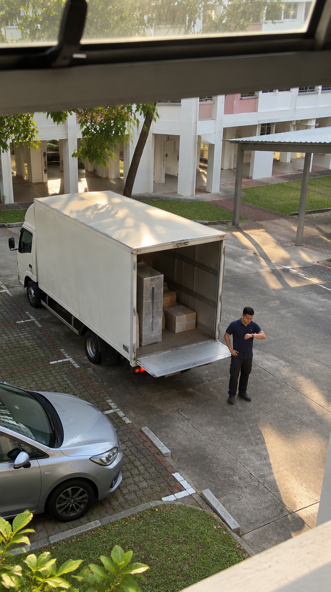

# Sample · Kakis Movers, "The Last Box" (fictional)

*This founder, company and story are invented as a practice sample.* Starting point: **finished script**, so all timings are **EST** at about 2.2 words/s. Length: about 84 s organic, about 95 s ad. **Revision v2** (Enjo, 24 Nov): beat 2 now sets up the speed payoff, the CTA is softer, beat 1 and beat 3 are tighter, and the uncle's box appears in beat 5.

## 1 · Script

**Hooks**
| # | Name | Line | Overlay | Visual direction |
|---|---|---|---|---|
| H1 | The Box | "I still keep the cardboard box I packed when I was nine. We moved six times before I turned twelve." | *We moved 6 times before I was 12.* | Rachel at her office desk, holding the worn box on her lap, talking to camera |
| H2 | The Cupboard | "One uncle told my movers, 'Don't touch that cupboard.' So I stopped the whole job." | *"Don't touch that cupboard."* | Cold open on a closed cupboard in an empty HDB flat, then cut to Rachel talking to camera |
| H3 | The Rule | "My moving company has one rule that loses us money on every single job. Here's why I keep it." | *The rule that costs us money every job.* | Rachel in a truck's loading bay, one box beside her, talking to camera |

**Bridge:** "Let me tell you where it started."

**Body**
- **Beat 1 · The Box:** Growing up, we rented HDB flats. Six moves before I was twelve. Each move, my mum gave me one box. "Whatever fits, you keep." I wrote on it: *Rachel. Don't throw.*
- **Beat 2 · The Business:** Today I run Kakis Movers. My crew can empty a four-room flat in three hours. Speed is how we win. Steady lah.
- **Beat 3 · The Uncle:** We moved an uncle out of his flat. His wife had just passed. My guys were taping everything. Then he stood in front of one cupboard. "Don't touch that."
- **Beat 4 · The Turn:** I told the crew, stop. I put down the tape gun. And I sat on the floor with him, and we packed her things together. One hour. Truck waiting downstairs. Money burning.
- **Beat 5 · The Echo:** Now every job we do ends with one last box. The owner packs it. We just carry it.

**Organic close:** "Because when you move, you're not moving furniture. You're deciding what you get to keep."
**Ad CTA:** "If you're moving soon, let us handle everything else. Your last box, you pack. We'll just carry it. Free walk-through, link's around this video."
**Posting caption:** We moved 6 times before I was 12. Now every move we do ends the same way: one last box, packed by you. 📦

## 2 · Story brief

| Field | Entry |
|---|---|
| **Founder** | Rachel Lim, 38, founder of Kakis Movers, Singapore. Warm and brisk, with a bit of humour. Keep "steady lah" and her clipped sentences |
| **Audience** | HDB families and older owners downsizing or upgrading, who see movers as a stressful cost |
| **Source material** | Real: the childhood box (she still has it), trucks, crew B-roll, office, Rachel on camera. Needs illustrating: the 1990s childhood moves and the uncle's flat |
| **Story arc** | Childhood moves → the one-box rule → a business that wins on speed → the uncle's cupboard → she stops the job → the "last box" ritual. **Resolved** |
| **Turning point** | Rachel **puts the tape gun down on the floor** and sits beside the uncle at the open cupboard. She breaks her own rule ("speed is how we win"), and the waiting truck makes the cost visible |
| **Visual anchor** | **The box marked "RACHEL — DON'T THROW."** Seen in the hook, packed as a child in beat 1, echoed by the uncle's box in beat 4, which returns, packed and taped, in the beat 5 montage |
| **Intended ending** | Organic: an owner's hands write their own name on a last box, then cut to Rachel's old box on her office shelf. Ad: stay on the owner's hands on their box under the CTA, with the logo and offer as small text only at the very end |
| **Questions for Enjo** | 1. Should the uncle show his face, or only hands and his back? 2. Do we show the late wife in a photo, or keep her only as the cupboard? 3. Which hook leads the ad set? |

## 3 · Edit plan (EST)

**Refs:** CHAR-R = Rachel adult sheet · CHAR-K = Rachel aged 9 · CHAR-M = mum · CHAR-U = uncle · LOC-1 = 1990s HDB rental · LOC-2 = uncle's four-room flat · PROP = the box (real photo) · REAL = trucks, crew, office

| # | VO line or timecode | What the viewer sees | Asset or reference | Cut or sound cue | Gen? |
|---|---|---|---|---|---|
| H1 | 0:00–0:09.5 hook | Rachel at her desk with the worn box on her lap. She taps the marker on the lid on "nine." Overlay on "six times" | **REAL** (film Rachel on a phone), or GEN lip sync (library #1) | Hard cut into the bridge | – |
| BR | 0:09.5–0:13 "Let me tell you where it started." | She lifts the lid. Match cut into the past | REAL | Cardboard flap SFX (library) | – |
| 1 | 0:13–0:19 "Growing up, we rented HDB flats. Six moves before I was twelve." | Locked frame of the same HDB doorway, hard-cut 3 times: different gate colour, different family shoes, the same girl, a little older each time | GEN · CHAR-K, LOC-1 (library #5) | Hard cut on each "moved." Sound of a gate closing on each (library) | G1 |
| 2 | 0:19–0:28 "Each move, my mum gave me one box… Don't throw." | Mum's hands hand over an empty box. Kid Rachel kneels and writes on it in marker. Insert of the **real** box lettering | GEN · CHAR-M (hands only), CHAR-K · PROP real photo insert | Marker squeak SFX (library, or MISSING) · soft music in | G1 |
| 3 | 0:28–0:38 "Today I run Kakis Movers… Speed is how we win. Steady lah." | **Speed montage:** a crew empties a flat in hard cuts on the beat, a wall clock jumps forward, the truck doors slam. Rachel gives a small nod to the camera on "steady lah" | **REAL** B-roll (film a real job) | Music picks up · cuts on the beat · tape rip SFX. **This sets up the slow-down in rows 4–7** | – |
| 4 | 0:38–0:44 "We moved an uncle out of his flat. His wife had just passed." | Uncle's flat, half-packed. A woman's slippers still by the door. The uncle stands in the hallway | GEN · CHAR-U, LOC-2 | Music drops to near silence on "passed" | G2 |
| 5 | 0:44–0:52 "My guys were taping… 'Don't touch that.'" | Crew taping in the background. The uncle steps in front of a closed wooden cupboard, one hand flat on the door | GEN · CHAR-U, LOC-2 | Tape stops abruptly · 0.5 s of silence after "that" | G2 |
| 6 | 0:52–1:04 "I told the crew, stop… packed her things together." | **Turning point:** Rachel raises a hand and the crew freezes. She **sets the tape gun on the floor**, sits beside the uncle, and they fold a cardigan together | GEN · CHAR-R, CHAR-U, LOC-2 | Tape gun clack (library) · music returns softly | G3 |
| 7 | 1:04–1:08 "One hour. Truck waiting… Money burning." | Insert of the clock on the wall. Wide shot from outside the window: the truck idling below, a crew member checking his watch | GEN (or REAL truck B-roll) | Engine idle (library) | G3 |
| 8 | 1:08–1:17 "Now every job… We just carry it." | Today, several homes in quick cuts: different owners writing their names on a box. **The uncle's box returns, packed and taped, with his handwriting on it.** A crew member carries it with both hands | **REAL** (stage it with real clients or staff) | Marker squeak · music lifts | – |
| OC | 1:17–1:24 close | Rachel's office shelf: her childhood box. She glances at it and smiles | REAL | Music resolves | – |
| CTA | 1:24–1:35 ad only | Hold on the owner's hands resting on their box at the new flat. Small logo and offer text only in the last 2 s | REAL | Music bed stays soft · no hard sell cut | – |

**Slop risks:** marker text on the box (always use the **real** photo insert for the lettering) · crowd crew moves (keep them in the background) · a time-lapse clock (use a single insert instead) · grief over-acting (library #8: understated, no crying)
**Estimate:** `python3 tools/estimate.py --gen-seconds 19 16 16 --risk high` gives about 890 credits at 7/s. Confirm the current rate.

### Prompts (generated shots only)

**G1 · rows 1–2 · 19 s · 9:16**
```
19-second photorealistic 9:16 video, 1990s Singapore HDB, faded colour, soft film grain. Multi-shot with hard cuts.
@Image 1 = girl, age 9 (identity, school-holiday clothes; do not copy the sheet layout). @Image 2 = HDB rental doorway and corridor. @Image 3 = mum (hands and torso only).
0–10 s: The same locked-off corridor view of a flat doorway, shown three times with hard cuts at about 3.5 s and 7 s. Each time the metal gate is a different colour, different shoes sit by the door, and the girl stands holding one cardboard box, slightly older. She doesn't look at the camera.
10–15 s: Inside an emptied room, mum's hands hold out a flat, empty cardboard box to the girl. The girl takes it with both hands.
15–19 s: The girl kneels on the floor and writes on the box lid with a thick black marker, concentrating. The camera is positioned so the lettering is NOT visible.
Audio: room ambience only. No speech, music or SFX. No readable text anywhere.
Keep the girl's face and haircut consistent; she ages only slightly across the three doorway shots.
```

**G2 · rows 4–5 · 16 s · 9:16**
```
16-second photorealistic 9:16 video, present-day Singapore four-room HDB flat, half-packed, ordinary daylight, phone-camera look.
@Image 1 = uncle, about 70 (identity, singlet and slacks). @Image 2 = the flat (layout, wooden cupboard, corridor).
0–6 s: Wide hallway view. Stacked boxes, a pair of woman's slippers still by the door. The uncle stands still in the hallway, looking toward the bedroom.
6–12 s: Medium shot. In the background, two movers (backs to camera) tape boxes. The uncle walks to a closed wooden cupboard and stands in front of it.
12–16 s: Close-up. He places one hand flat on the cupboard door and holds it there. His face is calm and firm, not crying.
Audio: ambience only. No speech, lip movement, music or SFX. No logos on boxes or shirts.
```

**G3 · rows 6–7 · 16 s · 9:16**
```
16-second photorealistic 9:16 video, the same flat as @Image 3, phone-camera look.
@Image 1 = Rachel, 38 (identity, navy company polo with no logo). @Image 2 = uncle. @Image 3 = flat and cupboard.
0–4 s: Medium shot. Rachel raises one open hand toward the crew off-screen. A mover's hands in the foreground stop mid-tape.
4–8 s: Close on Rachel's hand slowly setting a tape gun down on the floor.
8–13 s: Wide shot. Rachel sits on the floor beside the uncle at the open cupboard. They fold one cardigan together and place it in a single box. Quiet, unhurried.
13–16 s: Hard cut. Exterior view down from the window: a moving truck idling in the carpark below, a mover checking his watch.
Audio: ambience only. No speech, music or SFX. No logos or text.
Keep both faces and outfits consistent.
```

## 4 · Delivery

6 files, for example `KakisMovers_R01_H1_Organic_v1` … `KakisMovers_R01_H3_Ad_v1`. Tracking code: not supplied. Status: **Draft**. Use the full checklist in `templates/revision-delivery-checklist.md`.

## 5 · Sample keyframes

These were generated with Higgsfield GPT Image 2.6 (9:16, 1k), about 0.75 credits each. The three character sheets were made first and used as references, which keeps faces and outfits consistent across beats. Frames are concept stills for gate 2, not final footage.

| H1 · hook | Row 1 · doorway | Row 2 · the box | Row 5 · "Don't touch that." |
|---|---|---|---|
|  |  |  |  |

| Row 6 · **turning point** | Row 7 · truck waiting | Organic close |
|---|---|---|
|  |  |  |

**Character sheets:** [Rachel, 38](kakis-movers-frames/ref-rachel-adult.png) · [Rachel, 9](kakis-movers-frames/ref-rachel-kid.png) · [Uncle](kakis-movers-frames/ref-uncle.png)

**Review notes (checked against the slop-risk list):** faces and outfits hold across the frames, and the tape gun reads clearly in the turning point. The close frame shows a real landmark skyline through the window. Swap it for a plain HDB view if the brand should feel heartland rather than CBD. No readable text or logos appeared.
