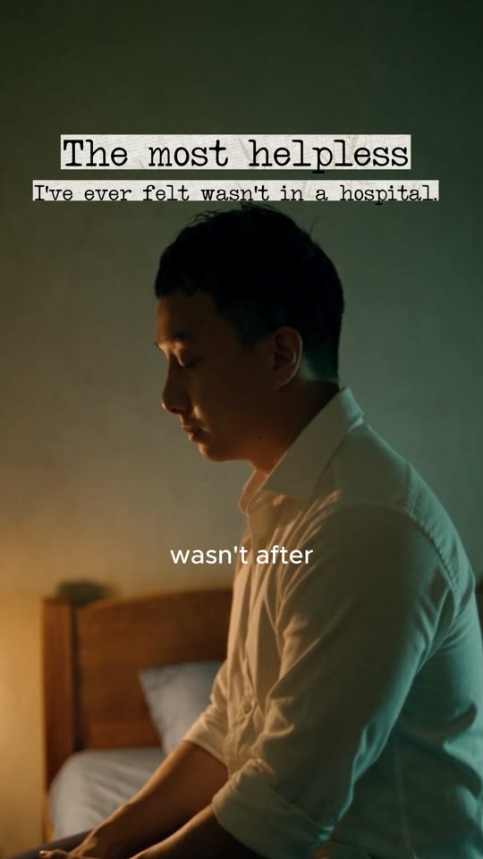
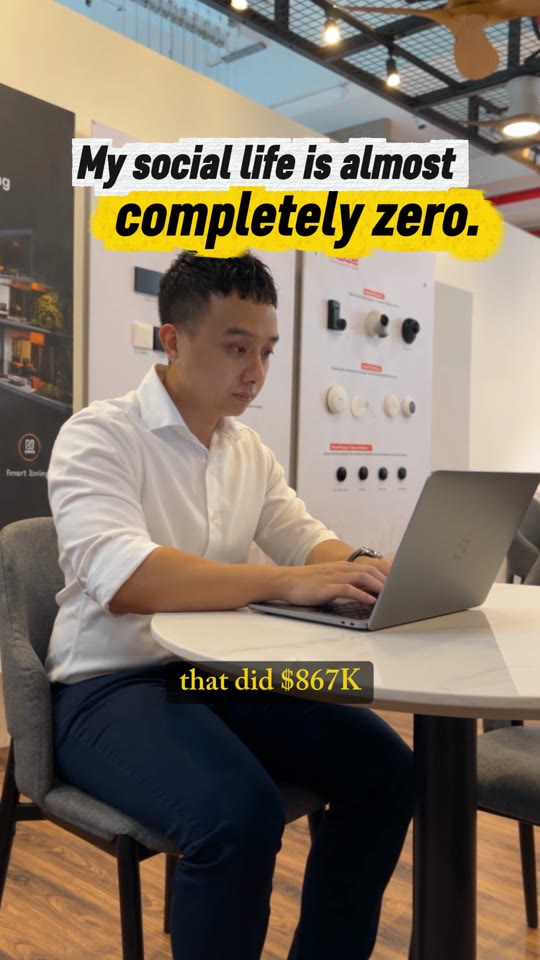
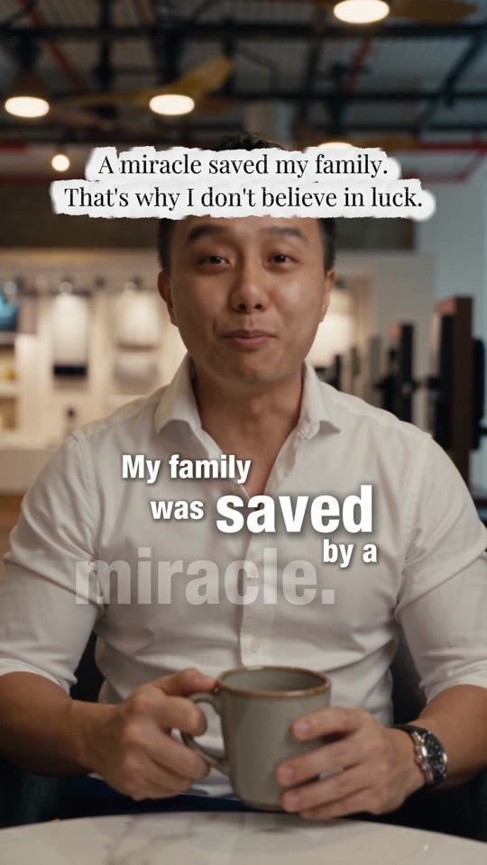
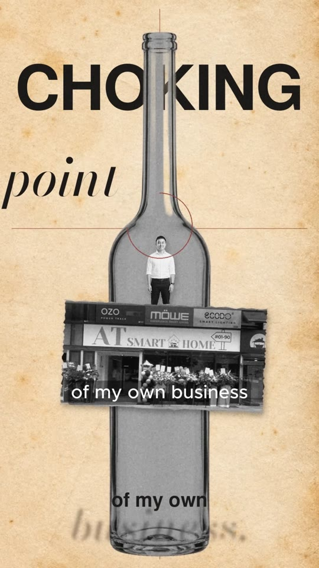
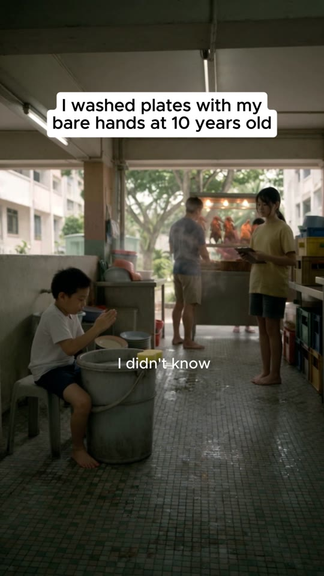
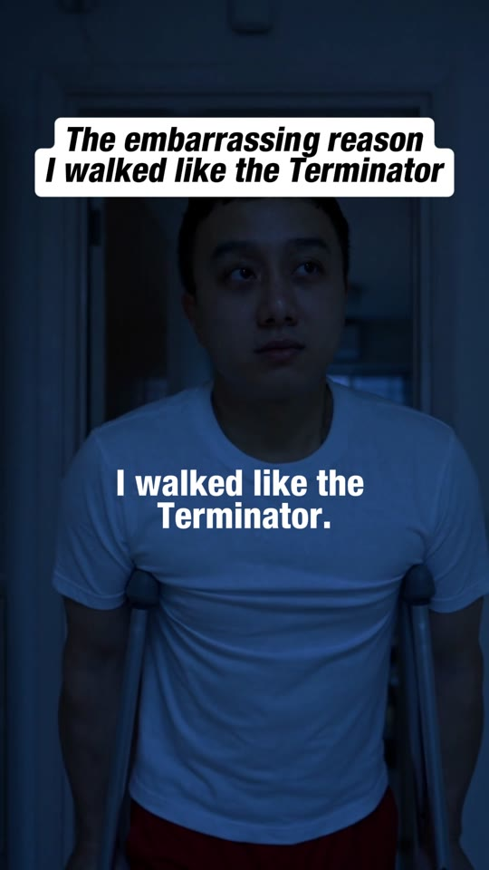

# Showcase · Adrian Tan reels (best hook per script)

These are finished cuts from the real campaign the playbook was built from: six reels, three hooks each, all leading into a shared body. The best hook of each script was chosen by comparing the first 10 seconds side by side. Each preview is the **first 15 s** at 540×960. Click a poster to play it.

> Real client work. Keep this repo private.

| Reel | Best hook | Why it wins |
|---|---|---|
|  **1 · A Room I Couldn't Fix** | **H3 · The Helpless Feeling** | Adult Adrian and his 10-year-old self share the same frame at the bedroom door. Past and present in one shot is the strongest visual idea in the set |
|  **2 · A Different Kind of Prison** | **H3 · The Price Tag** | A specific number ("$867K") with "social life… zero" over the reveal, ending on the direct-to-camera line. This is the reel traced in the [case study](../../case-studies/adrian-reel-2-trace.md) |
|  **3 · I Don't Believe In Luck** | **H1 · The Miracle** | A contradiction in the first line ("A miracle saved my family. That's why I don't believe in luck.") plus kinetic emphasis on "saved by a miracle." H3 is more cinematic, but its first frames are too dark to read on a phone |
|  **4 · I'm The Choking Point** | **H1 · The Admission** | The bottle-neck collage makes the metaphor visible within 2 s, and it's the most distinctive design in the set |
|  **5 · I Hate Washing Plates** | **H2 · The Sponge** | Opens on the story's visual anchor (the sponge), then cuts straight to the kid's bare hands in the pail |
|  **6 · I Had No One I Could Reach** | **H2 · The Terminator** | Comedy hook with the payoff on screen: the blue night, the crutches, one step at a time |

## Notes from the review
- **The first frame shows an empty white caption box** on Reels 1, 6 (all hooks) and 3 (H1), because the overlay animates in. On IG the first frame is often the preview, so start the overlay already filled, or with the text in place from frame 0.
- **The bridge cards** ("Let me tell you…", "Let me be honest…") type on over black for about 1 s. They work, but a frame of the next shot behind them would keep the energy up.
- These picks are a **visual first-10-seconds judgement**. Once the hooks are posted, replace them with real numbers in [`logs/hook-scoreboard.csv`](../../logs/hook-scoreboard.csv).
